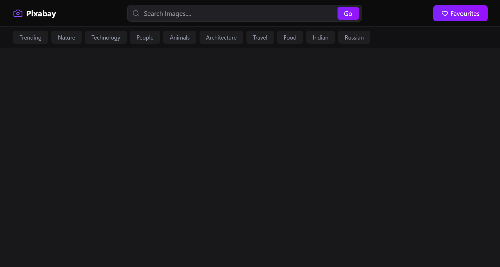
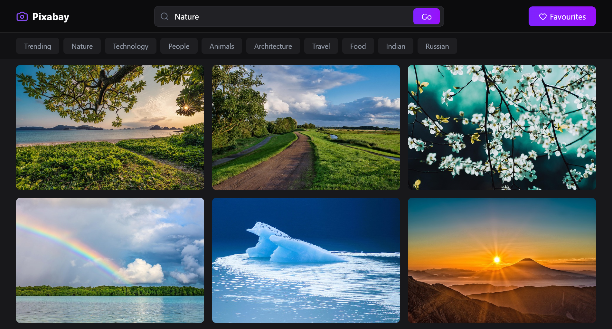
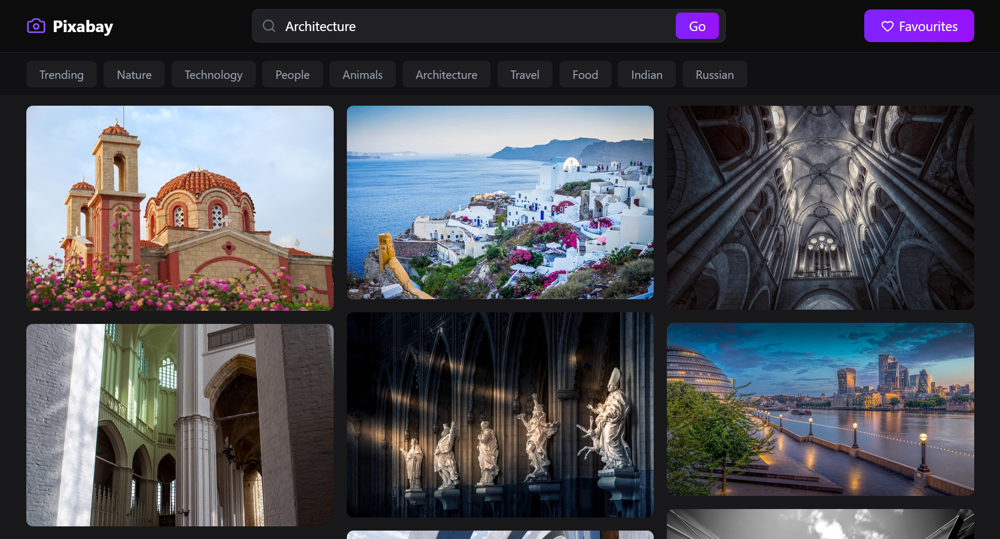
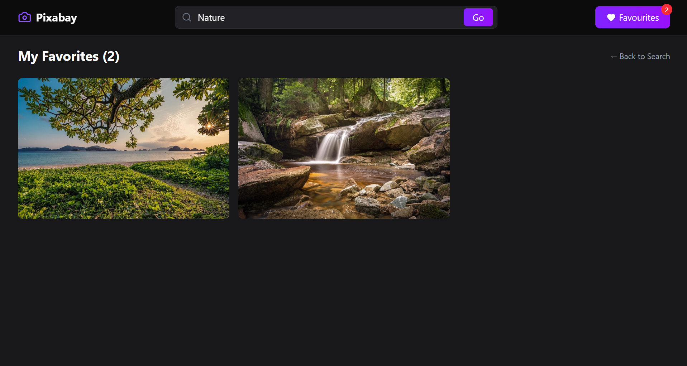

# 🖼️ Pixabay Image Search Clone

> A React.js application for searching, exploring, and saving high-quality images using the Pixabay API.

Pixabay Image Search Clone is a responsive web application that allows users to discover images using keywords and categories. Users can explore image collections, manage their favorite images, and browse search results through a clean and intuitive interface.

## ✨ Features

### 🔍 Image Search & Discovery

* Search for images using keywords.
* Explore images by category.
* Fetch and display images dynamically using the Pixabay API.
* Browse image search results through an intuitive interface.
* Navigate through multiple pages of search results.

<p align="center">
  
</p>

<p align="center">
  
</p>
<p align="center">
  
</p>

### ❤️ Favorites Management

* Add images to your favorites.
* View and manage saved images.
* Easily access your favorite image collection.

<p align="center">
  
</p>

### 📱 Responsive User Interface

* Responsive image grid layout for different screen sizes.
* Clean and user-friendly design.
* Lazy loading for efficient image loading.
* Loading states for a smoother browsing experience.

---

## 🛠️ Tech Stack

| Category          | Technology   |
| ----------------- | ------------ |
| Frontend          | React.js     |
| Styling           | Tailwind CSS |
| API               | Pixabay API  |
| Deployment        | Vercel       |
| Development Tools | VS Code      |
| Version Control   | Git & GitHub |

---

## 💡 Technical Highlights

* Integrated the Pixabay API to fetch and display images dynamically.
* Implemented image search using keywords and categories.
* Built reusable React components for a maintainable codebase.
* Used React hooks and custom hooks to manage application functionality.
* Implemented favorites management for saving images.
* Added pagination and lazy loading to improve the browsing experience.
* Developed a responsive user interface using Tailwind CSS.

---

## 🚀 Live Demo

🔗 [Pixabay Image Search Clone](https://pixabay-clone-nine-gold.vercel.app/)

---

## ⚙️ Getting Started

### 1. Clone the Repository

```bash
git clone https://github.com/sidd-singh04/Pixabay-Clone.git
cd Pixabay-Clone
```

### 2. Install Dependencies

```bash
npm install
```

### 3. Configure the Pixabay API

Set up your Pixabay API key according to your project's environment-variable configuration.

### 4. Start the Development Server

```bash
npm run dev
```

Open the local URL displayed in your terminal to access the application.

> **Note:** The commands above assume your project uses Vite. Adjust them if your project uses a different setup.

---

## 👨‍💻 Author

**Siddharth Singh**
GitHub: [@sidd-singh04](https://github.com/sidd-singh04)
